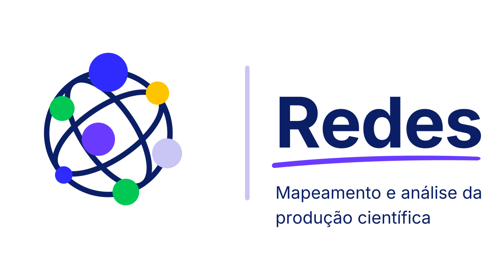
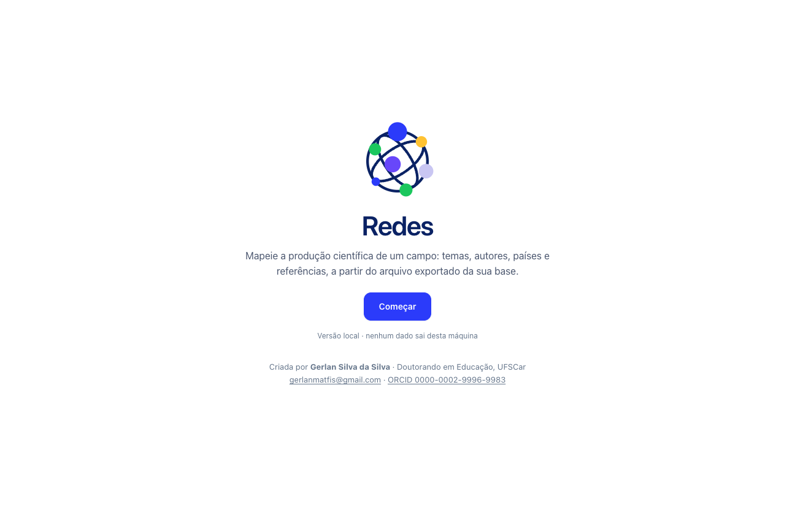
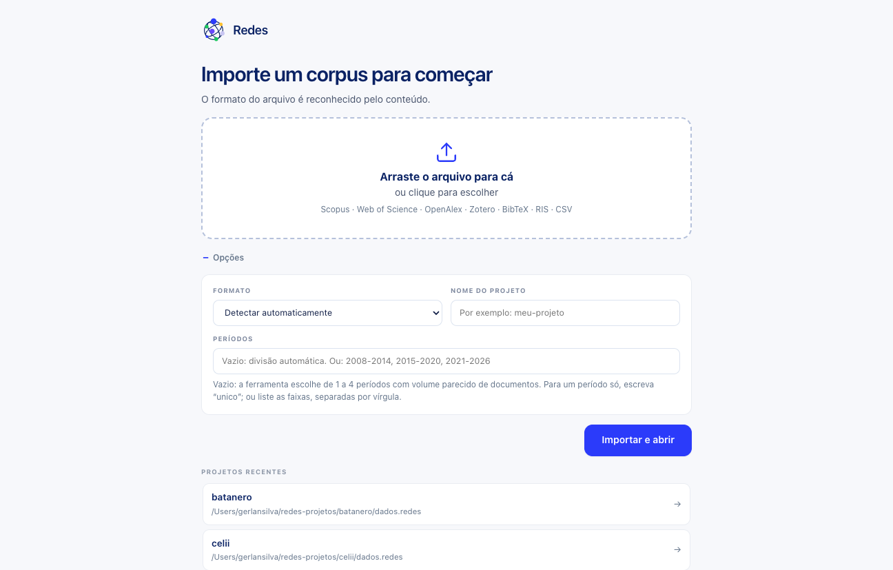
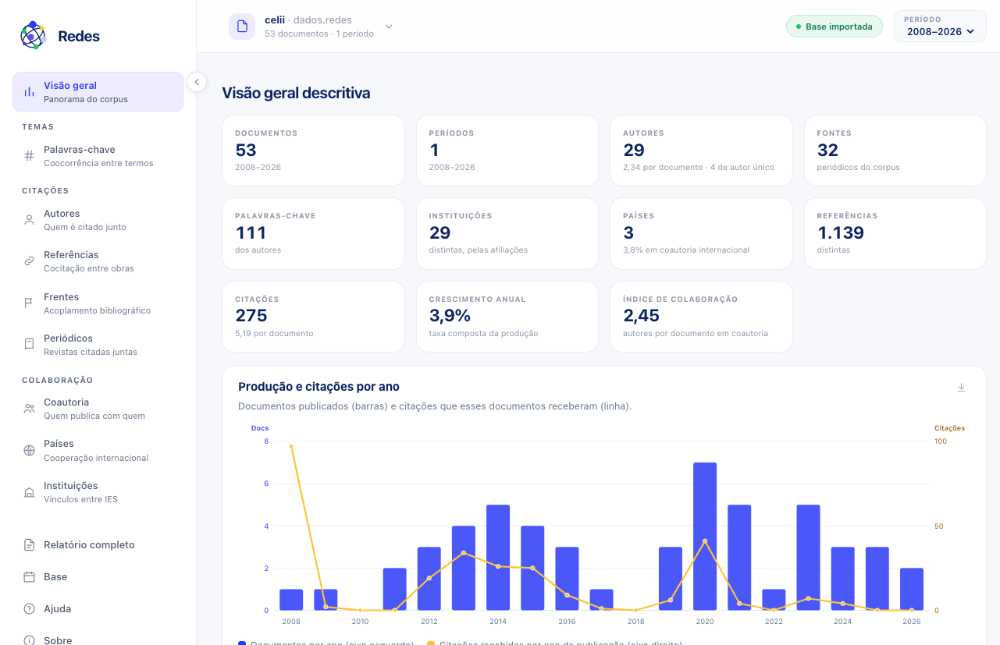
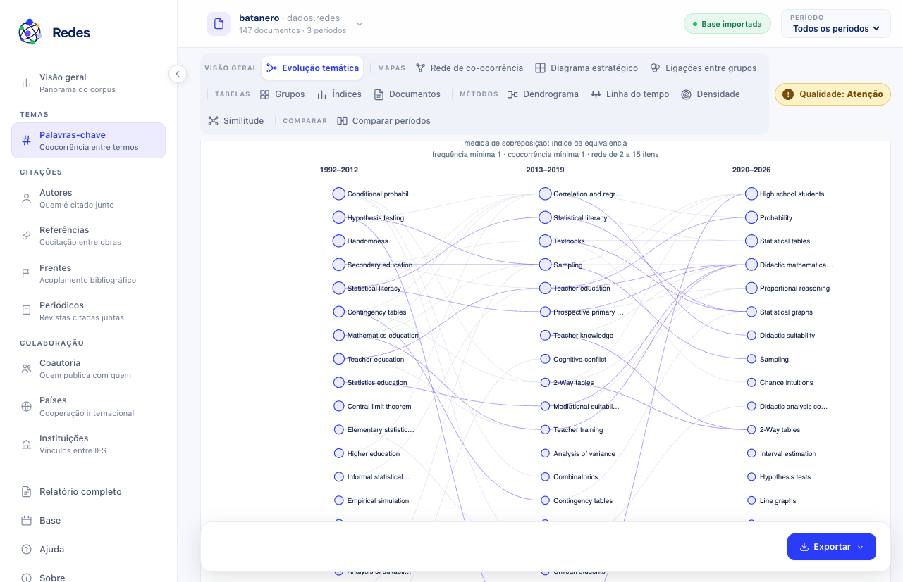
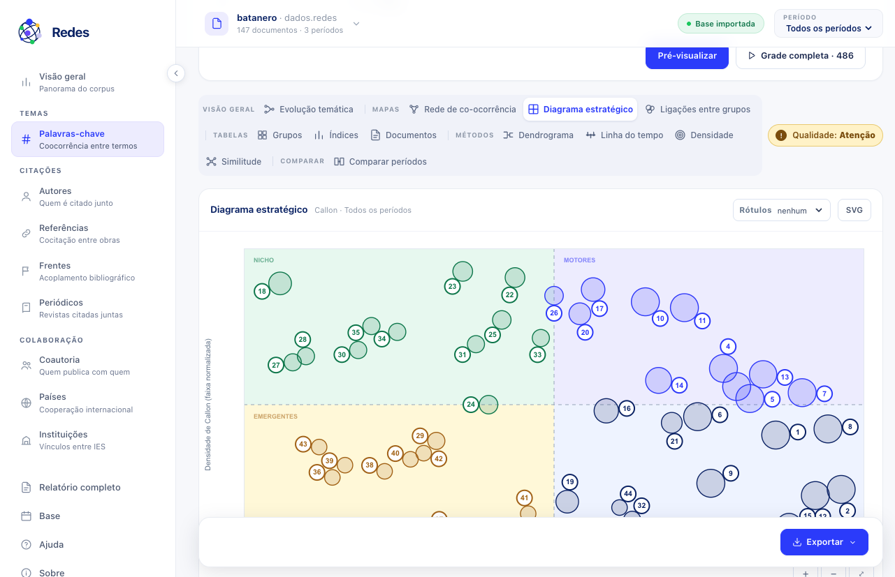
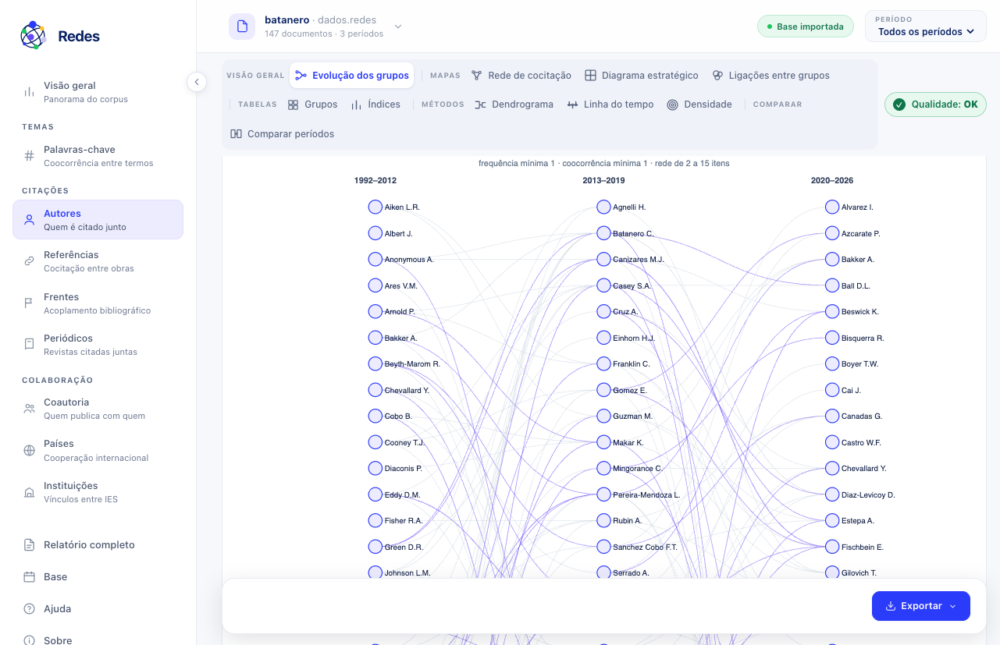
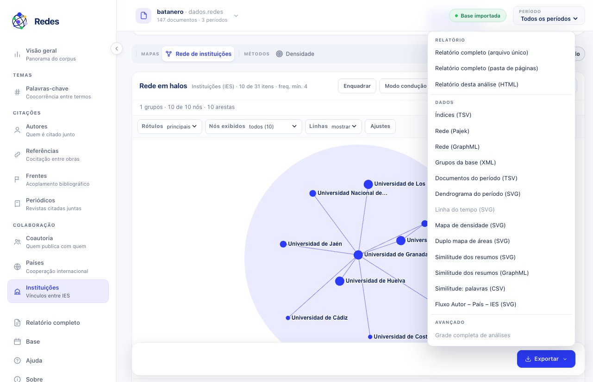

<p align="center">
  
</p>

# Redes

**Mapeamento científico e análise de redes da produção acadêmica, com interface web local em português.** Importe o arquivo exportado da sua base (Scopus, Web of Science, OpenAlex, Zotero, BibTeX, RIS ou CSV) e veja temas, autores, referências e colaboração, período a período.


## Galeria

| | |
|---|---|
|  |  |
|  |  |
|  |  |

As capturas usam metadados públicos de artigos de dois corpora de pesquisadoras da Educação Estatística. Todas as imagens estão em [`docs/imagens/`](docs/imagens/) e aparecem no [guia de uso](docs/guia-de-uso.md).

## O que o Redes faz

As análises respondem a quatro perguntas:

| Pergunta | Análise no menu | Base da análise |
|---|---|---|
| **O que se escreve?** | Temas | co-ocorrência de palavras-chave |
| **Em quem se apoia?** | Autores, Referências, Frentes, Periódicos | cocitação e acoplamento bibliográfico |
| **Com quem se escreve?** | Coautoria, Países, Instituições | coautoria e afiliações |
| **Como isso muda no tempo?** | Evolução temática | sobreposição de temas entre períodos |

Além disso: visão geral descritiva (produção, citações, leis de Lotka, Bradford e Zipf, rajadas), diagrama estratégico (centralidade e densidade), rede em halos, índices (h, g e outros), linha do tempo e relatório completo em HTML com as ressalvas de leitura. Detalhes em [docs/analises.md](docs/analises.md).

## Para quem é

Pesquisadoras e pesquisadores que fazem revisão de literatura, estado da arte ou estudos bibliométricos e querem uma ferramenta em português, local (nenhum dado sai da sua máquina) e sem programar.

## App para macOS e Windows

Baixe o instalador na página de [Releases](https://github.com/gerlansilva/redes/releases):

- `Redes-<versão>-macOS-arm64.dmg` (Apple Silicon): arraste **Redes** para **Aplicativos**. Na primeira abertura, clique com o botão direito em **Redes** e escolha **Abrir**: o app é assinado localmente e não é notarizado pela Apple.
- `Redes-<versão>-Windows-x64-setup.exe` (Windows 10/11, 64 bits): execute o instalador e abra o **Redes** pelo menu Iniciar.

O app abre a mesma interface em uma janela própria, com o servidor Python embutido — não é preciso instalar Python.

## Instalação

Requer Python 3.10 ou mais novo.

```bash
python3 -m venv ~/venv_redes
source ~/venv_redes/bin/activate
pip install git+https://github.com/gerlansilva/redes
# ou, com o repositório clonado:
pip install .
redes --version
```

## Início rápido

**Interface web**

```bash
redes web                # abre http://127.0.0.1:8765
```

Clique em *Começar*, escolha o arquivo exportado, informe (opcional) os períodos, por exemplo `2010-2015, 2016-2020`, e clique em *Importar e abrir*. Passo a passo com capturas: [guia de uso](docs/guia-de-uso.md).

**Linha de comando** (usando o exemplo sintético incluído)

```bash
redes constroi examples/exemplo_sintetico.csv --saida exemplo.redes --periodos "2009-2013, 2014-2018, 2019-2023"
redes analisa exemplo.redes --unidade Words --saida palavras.tsv     # também grava palavras_grupos.tsv
redes analisa exemplo.redes --unidade AuthorsReference --saida citados.tsv
redes grade exemplo.redes --saida grade.tsv                          # todas as análises
```

Todos os comandos e opções: [linha-de-comando.md](docs/linha-de-comando.md).

## Formatos de entrada

CSV tabulado do Redes, BibTeX, RIS, OpenAlex (CSV), Web of Science (texto), Scopus (CSV) e Zotero (CSV ou RIS). O formato é reconhecido pelo conteúdo. Colunas esperadas e exemplos mínimos: [formatos-de-entrada.md](docs/formatos-de-entrada.md).

## Saídas

TSV (resumo e grupos por tema), SVG (rede e diagrama estratégico), PNG, SVG e CSV dos gráficos da visão geral, HTML (relatório de uma análise e relatório completo, em arquivo único ou pasta), Pajek (`.net`), GraphML e XML de grupos. A grade completa grava um TSV com todas as configurações.



## Limites mínimos: como interpretar

O Redes nunca bloqueia uma análise. Quando um período tem menos de 20 documentos, mais da metade dos temas com um só documento, um tema com mais de 40% dos documentos, termo presente em 35% ou mais dos documentos, menos de 10 itens citados por dois ou mais documentos (cocitação) ou um corpus de autor focal, o resultado é marcado pelo selo de **Qualidade** e o *Relatório completo* registra a ressalva junto da análise. Um aviso significa "leia como indício". Veja [docs/analises.md](docs/analises.md#avisos-de-limite-mínimo).

## Desenvolvimento e testes

```bash
pip install -e ".[teste]"
pytest -q
```

Os testes de interface usam Playwright e Chrome; sem eles, são pulados. Estrutura do pacote e como contribuir: [desenvolvimento.md](docs/desenvolvimento.md). Mudanças por versão: [CHANGELOG.md](docs/CHANGELOG.md). Dúvidas comuns: [perguntas-frequentes.md](docs/perguntas-frequentes.md).

## Como citar

Veja [CITATION.cff](CITATION.cff). Sugestão:

> SILVA, Gerlan Silva da. *Redes: mapeamento científico e análise de redes da produção acadêmica* (versão 0.1.1). 2026. Disponível em: https://github.com/gerlansilva/redes.

## Referências metodológicas

- CALLON, M.; COURTIAL, J.-P.; LAVILLE, F. Co-word analysis as a tool for describing the network of interactions between basic and technological research: the case of polymer chemistry. *Scientometrics*, v. 22, n. 1, p. 155-205, 1991.
- KLEINBERG, J. Bursty and hierarchical structure in streams. In: *Proceedings of the 8th ACM SIGKDD International Conference on Knowledge Discovery and Data Mining*, 2002, p. 91-101.
- CHEN, C. CiteSpace II: detecting and visualizing emerging trends and transient patterns in scientific literature. *Journal of the American Society for Information Science and Technology*, v. 57, n. 3, p. 359-377, 2006.
- CHEN, C.; LEYDESDORFF, L. Patterns of connections and movements in dual-map overlays: a new method of publication portfolio analysis. *Journal of the Association for Information Science and Technology*, v. 65, n. 2, p. 334-351, 2014.
- COBO, M. J.; LÓPEZ-HERRERA, A. G.; HERRERA-VIEDMA, E.; HERRERA, F. An approach for detecting, quantifying, and visualizing the evolution of a research field: a practical application to the Fuzzy Sets Theory field. *Journal of Informetrics*, v. 5, n. 1, p. 146-166, 2011.
- BLONDEL, V. D.; GUILLAUME, J.-L.; LAMBIOTTE, R.; LEFEBVRE, E. Fast unfolding of communities in large networks. *Journal of Statistical Mechanics: Theory and Experiment*, P10008, 2008.

## Licença

GPL-3.0-or-later. Veja [LICENSE](LICENSE).

## Autoria

Gerlan Silva da Silva, doutorando em Educação na Universidade Federal de São Carlos (UFSCar). ORCID: [0000-0002-9996-9983](https://orcid.org/0000-0002-9996-9983). Criado para as análises de uma tese sobre a constituição do campo de pesquisa em Educação Estatística.

## Agradecimentos

Agradeço a quem testou o Redes, às pessoas e instituições que mantêm bases abertas de metadados científicos e às bibliotecas de código aberto (NetworkX, NumPy) sobre as quais ele foi construído.
