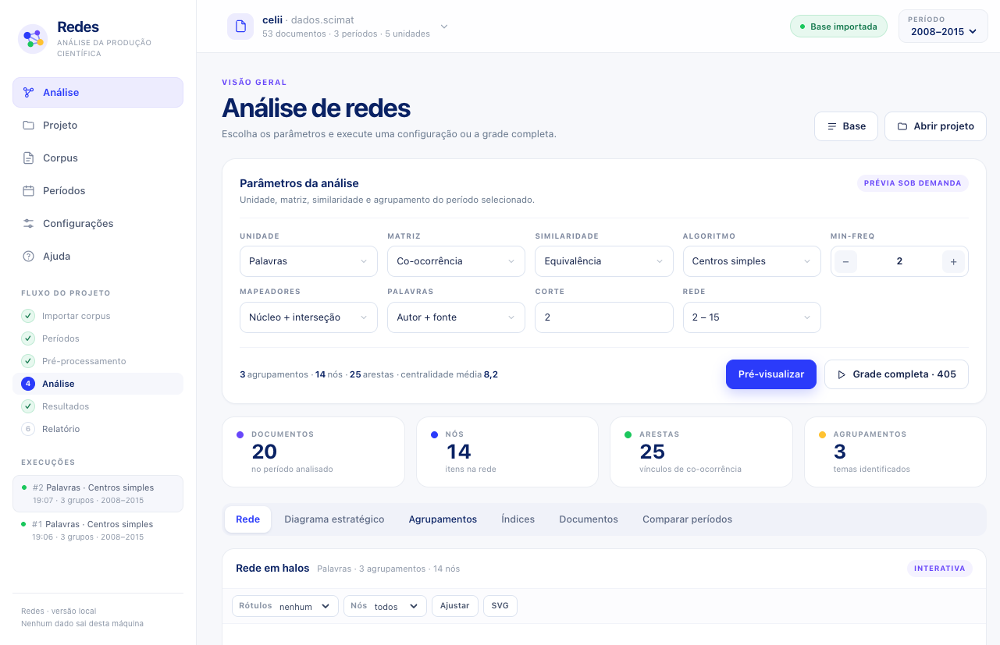
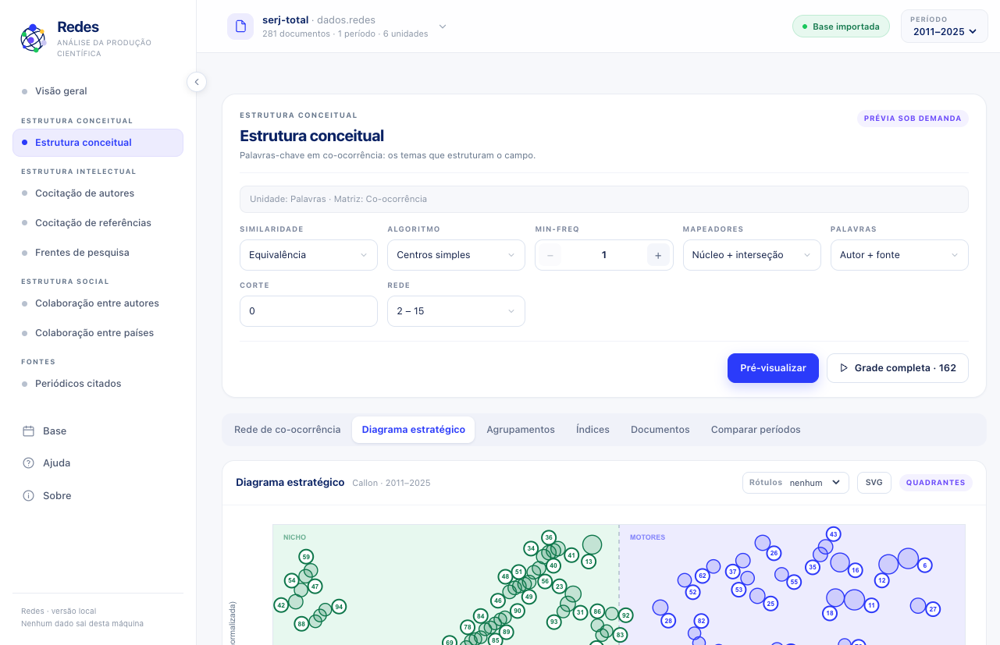
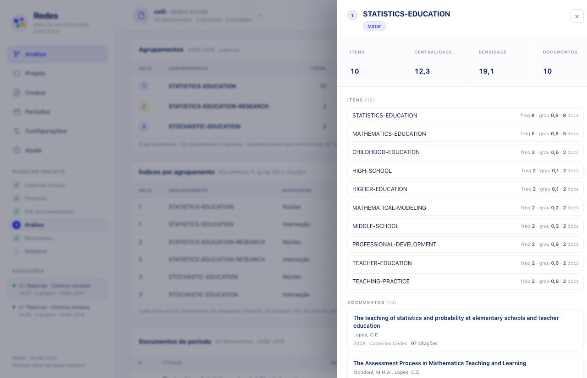
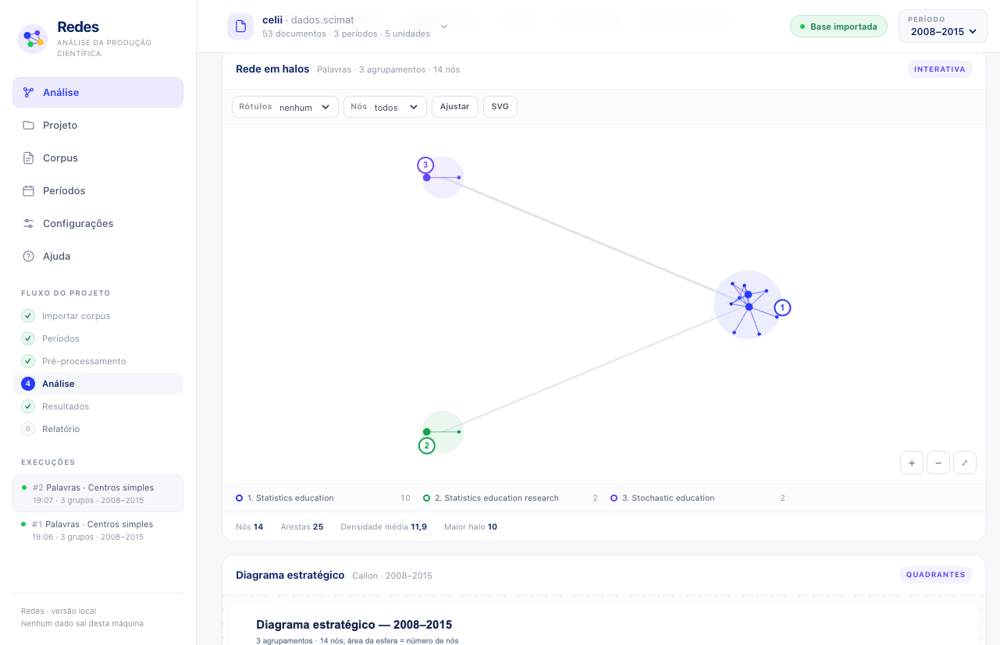
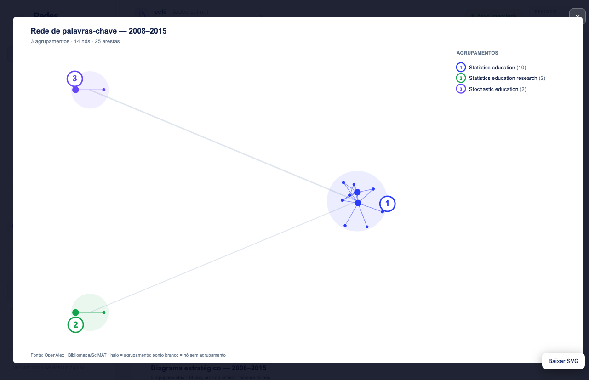
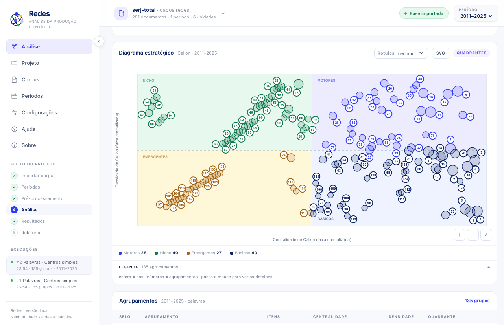

# Redes

**Redes** é a ferramenta de mapeamento e análise da produção científica. O
pacote Python que a executa chama-se `scimatpy` internamente: ele reimplementa
o fluxo do SciMAT, com as mesmas decisões algorítmicas do programa original e
figuras no estilo do atlas
[relimeARS](https://github.com/gerlansilva/relimeARS) — halos por agrupamento,
selos numerados e paleta própria.

O objetivo é ter o fluxo inteiro em Python: ler o corpus, montar a matriz,
normalizar, agrupar, medir, desenhar e relatar, sem depender da interface Java.

## Estado atual

| Etapa | Situação |
|---|---|
| Leitura de projeto `.redes` (SQLite), inclusive `.scimat` antigo | pronto, com as mesmas consultas e ordem do original |
| Conjunto documento × item (7 unidades, com países e instituições) | pronto |
| Conjunto agregado por autor e por periódico | pronto |
| Redes de co-ocorrência, acoplamento e acoplamento agregado | pronto |
| Similaridades (equivalência, associação, inclusão, Jaccard, Salton) | pronto |
| Agrupamento: centros simples, média, completa, simples, soma, Louvain | pronto |
| Redução por frequência e por valor de aresta | pronto |
| Centralidade e densidade de Callon, faixas normalizadas | pronto |
| Mapeadores de documentos (núcleo, secundário, k-core, interseção, união, acoplamento) | pronto |
| Índices h, g, hg, q2, citações (média, soma, mín., máx.) | pronto |
| Centralidade de nós (grau, intermediação, proximidade, autovetor, PageRank) | pronto |
| Rede em halos (SVG) | pronto |
| Rede interativa na interface (zoom, rótulos, filtro de nós) | pronto |
| Mapa de colaboração entre países (interativo, com zoom e destaque) | pronto |
| Diagrama estratégico (interativo, com SVG para exportar) | pronto |
| Mapas longitudinais (evolução e sobreposição) | pronto |
| Relatório HTML (com referências ABNT e página de visão geral descritiva) | pronto |
| Visão geral descritiva: produção, rankings, leis de Lotka/Bradford/Zipf, nuvens de palavras e rajadas (Kleinberg) | pronto |
| Revisar grafias: variantes de autores, palavras-chave, IES e países, com lista de grafias corretas e agrupamento (com desfazer) | pronto |
| Relatório completo (arquivo único ou pastas): cada análise traz parâmetros adotados, algoritmo em linguagem simples e tabela de indicadores por período | pronto |
| Fluxo Autor – País – IES (Sankey), com aviso do que falta quando a base não traz a afiliação por autor | pronto |
| Dendrograma (agrupamento hierárquico, corte, cofenética, ARI/NMI contra a rede) | pronto, aba no modo avançado (ver `docs/dendrograma.md`) |
| Qualidade do mapa: modularidade Q, comparação com o Louvain, silhueta por agrupamento e selo (OK, Atenção, Ruim, Indefinido) | pronto (ver `docs/qualidade.md`) |
| Rótulos por tema (LLR de Dunning sobre título, palavras-chave e bigramas do resumo) | pronto, só para palavras-chave e referências; autores, países e IES mantêm o nome do líder |
| Linha do tempo dos agrupamentos (estilo CiteSpace), com rajadas | pronto, corpus completo, aba no modo avançado (ver `docs/linha-do-tempo.md`) |
| Pontos de virada e sigma (intermediação alta, vizinhos em 2 ou mais agrupamentos) | pronto, só co-ocorrência; sigma só para quem tem rajada (ver `docs/linha-do-tempo.md`) |
| Mapa de densidade (estilo VOSviewer, SVG próprio) | pronto, corpus completo, aba no modo avançado (ver `docs/densidade.md`) |
| Similitude dos resumos (estilo IRaMuTeQ): árvore máxima, blocos de Louvain, resumos em inglês, português e espanhol | pronto, aba no modo avançado, SVG/GraphML/CSV e seção nos relatórios (ver `docs/similitude.md`) |
| Unidade Instituições (IES): união de variantes inequívocas do nome e componente mínimo de 3 instituições | pronto (ver `docs/ies.md`) |
| Parâmetros e método por análise nos relatórios (inclui qualidade, rótulos, linha do tempo, densidade, pontos de virada e IES) | pronto |
| Carregadores nativos (BibTeX, RIS, CSV, OpenAlex, WoS, Scopus) | pronto |
| Armazenamento próprio (`.redes` gravado pelo Python) | pronto: esquema do Bibliomapa (`v1_03`) mais as tabelas de países |
| Exportações (Pajek, GraphML, XML de grupos, TSV) | pronto |
| Edição da base (períodos, grupos, substituição, desfazer) | pronto |
| Interface web local (abrir/importar, análise, grade, figuras) | pronto |
| Detalhe de agrupamento (itens e documentos) | pronto |
| Navegador de índices na interface | pronto |

## Paridade com o Bibliomapa

A implementação foi conferida contra as saídas já geradas do fork Java do
SciMAT, em duas frentes:

1. **Relatórios completos** — 20 análises (5 unidades × 4 recortes de período; a unidade Países foi acrescentada depois):
   nós, arestas, partição em agrupamentos, frequência, grau ponderado e
   PageRank idênticos.
2. **Grade de análises** — 162 configurações; 540 comparações com a referência
   Java (135 no corpus completo e 405 nos três períodos): documentos, itens,
   itens após redução, número de grupos, maior grupo, grupos unitários, nós e
   arestas da rede, centralidade e densidade médias. **0 divergências.** As 27
   configurações da unidade Países não têm referência Java, porque a unidade
   foi acrescentada depois.

```bash
python3 scripts/paridade_lote.py     # relatórios, 20 análises
python3 scripts/grade.py completo    # grade do corpus completo
python3 scripts/grade.py periodos    # grade dos três períodos
```

## Uso

### Instalação e comando `redes`

Requer Python 3.10 ou mais novo (dependências: `networkx` e `numpy`). Num
ambiente virtual limpo:

```bash
python3 -m venv ~/venv_redes
~/venv_redes/bin/pip install /caminho/para/redes        # ou: pip install -e . (desenvolvimento)
~/venv_redes/bin/redes web                               # interface em http://127.0.0.1:8765
~/venv_redes/bin/redes --help                            # analisa, constroi, grade, web
```

`redes` é o ponto de entrada do pacote (`scimatpy` continua valendo como
sinônimo, e `python3 -m scimatpy web` também). A instalação inclui a interface
(`ui/`) e os recursos (`assets/`); foi conferida num ambiente virtual limpo, com
`pip install -e .` e com instalação comum, abrindo a interface e baixando
`/static/app.js`. Para os testes de interface: `pip install -e ".[teste]"` e
`python -m playwright install chromium` (sem isso esses testes pulam).

### Interface web

```bash
python3 -m scimatpy web
```

Abre `http://127.0.0.1:8765` no navegador, com os projetos em
`~/scimatpy-projetos` (mude com `--projetos`). A tela permite abrir um `.redes`
pelo caminho, importar um corpus novo e pré-visualizar qualquer configuração.
A grade completa roda em segundo plano, com progresso e cancelamento, e o TSV
fica disponível em "Baixar grade". Nada sai da máquina: o servidor escuta
apenas em `127.0.0.1` e não tem dependências além da biblioteca padrão.



A tela segue a identidade **Redes**: barra lateral com o logotipo, o menu de
análises agrupado por propósito e os atalhos **Base**, **Ajuda** e **Sobre**;
no topo ficam o projeto aberto e o período. Ao abrir um projeto, a página cai
na **Visão geral** do corpus (período, documentos, recortes e unidades, mais os
quatro cartões de resumo da análise). Clicar numa análise leva ao cartão de
parâmetros — com o nome da análise no título, os campos, **Pré-visualizar** e
**Grade completa** — e às abas de resultados. A exportação e o relatório ficam
no fim da página.

As análises são escolhidas no menu lateral, agrupadas por propósito, no estilo
do bibliometrix: **Estrutura conceitual** (palavras-chave), **Estrutura
intelectual** (cocitação de autores, cocitação de referências e frentes de
pesquisa), **Estrutura social** (colaboração entre autores e entre países) e
**Fontes** (periódicos citados). A colaboração entre instituições (IES) fica junto com a social. Clicar em uma análise preenche os parâmetros,
executa a prévia do período e destaca o item no menu. O cartão de parâmetros
mostra **Unidade**, **Matriz** e a frequência mínima; similaridade, algoritmo,
mapeadores, palavras, corte e tamanho da rede ficam em **Parâmetros
avançados**, recolhidos. Ao mudar qualquer campo fora do preset, a análise
passa para **Personalizada** e a prévia fica marcada como desatualizada.



O navegador só envia parâmetros e recebe JSON; a análise roda no processo
Python, com o mesmo `pipeline.py` e o mesmo `grade.py` do CLI. A prévia é uma
chamada síncrona; a grade é um trabalho em segundo plano com progresso por
consulta. Os SVGs são gerados no servidor e servidos por token, sem expor
caminhos arbitrários.

Clicar em um agrupamento abre um painel com os itens do grupo — frequência,
grau e número de documentos — e a lista de documentos com título, autoria, ano,
fonte e citações. Os detalhes vêm de uma chamada separada, para não inflar a
resposta da análise.



A rede em halos é desenhada em canvas a partir do mesmo layout do SVG, com
zoom pela roda do mouse, arraste para deslocar, botões de ampliar/reduzir e
"Ajustar". Os controles acima do desenho mudam os rótulos dos nós (nenhum,
principais ou todos) e filtram os nós exibidos por grau (todos, top 50 ou top
200); passar o mouse mostra o rótulo, a frequência e o grau, e clicar no nó
abre o agrupamento. Clicar em um selo também abre o grupo correspondente. A
legenda fica fora da área do desenho, com todos os agrupamentos e rolagem.





Acima de 30 agrupamentos ou 600 nós, a interface avisa e sugere filtrar os nós
ou aumentar a frequência mínima. A legenda das figuras se distribui em até
quatro colunas para não vazar da imagem; se ainda assim não couber, mostra
quantos agrupamentos ficaram de fora e remete à tabela.

O diagrama estratégico é estatístico e interativo: os eixos mantêm apenas os
títulos, sem números e sem malha, para não competir com os selos; a referência
de leitura é a cruz tracejada em 0,5. Passar o mouse mostra nome, nós, documentos,
centralidade e densidade; clicar abre o agrupamento. Arrastar, a roda e os botões ampliam e deslocam **apenas a área do
gráfico**: a moldura, os eixos e a legenda ficam fixos, e o domínio é limitado
para que nenhuma esfera cruze a borda; os quadrantes pintam a área inteira,
inclusive a folga das extremidades. As esferas seguem o padrão da figura
(preenchimento translúcido, contorno e selo numerado), e os selos dos
agrupamentos maiores têm prioridade; acima de determinado volume apenas os
maiores são numerados, para não poluir o gráfico.

Os quadrantes seguem Callon, com o corte em 0,5: **motores** combinam
centralidade e densidade altas; **de nicho**, densidade alta e centralidade
baixa; **emergentes ou em declínio**, ambas baixas; e **básicos e
transversais**, centralidade alta e densidade baixa. Em Países, os mesmos
quadrantes leem núcleos de cooperação, grupos isolados, periféricos e
cooperação dispersa. No gráfico, o nome curto de cada quadrante aparece no
canto com menos esferas, em tom suave; se o zoom deixar a área pequena, ele é
omitido. Passe o mouse sobre a legenda colorida para ver a definição de cada
um.

Abaixo do diagrama, a **Legenda** lista todos os agrupamentos com o mesmo
número do selo e da tabela: abre automaticamente até 24 grupos e, acima disso,
fica recolhida. Em telas largas se distribui em colunas com rolagem vertical,
sem estourar o cartão; o seletor **Rótulos** ainda permite escrever os nomes
principais ou todos sobre o gráfico. A figura SVG, com a legenda numerada,
continua disponível para exportação.



As abas de resultado se adaptam a cada análise — só aparece o que faz
sentido e uma delas abre ativa por padrão. A aba **Rede** muda de nome
conforme a análise (co-ocorrência, cocitação, acoplamento, coautoria, países
ou periódicos); **Países** aparece apenas na colaboração entre países;
**Documentos**, apenas quando os nós são documentos (frentes de pesquisa e
estrutura conceitual). **Diagrama estratégico**, **Rede de agrupamentos**,
**Agrupamentos**, **Índices** e **Comparar períodos** valem para todas, um
resultado por vez. A **Rede de agrupamentos** mostra cada tema como um nó,
com o tamanho proporcional aos itens, a cor pelo quadrante do diagrama
estratégico e as arestas pela associação entre os temas (índice de
equivalência de Callon). **Comparar períodos** (mapa de evolução e de
sobreposição) só aparece quando o projeto tem dois períodos ou mais. O
seletor **Exportar…** grava
índices em TSV, a rede em Pajek ou GraphML, os grupos da base em XML e os
documentos do período em TSV. **Relatório** gera o HTML completo em nova aba. O botão
**Base** abre o editor de períodos e grupos, com substituição de grafia e
desfazer.

**Abas do modo avançado.** Além das abas acima, o modo avançado mostra
**Dendrograma**, **Linha do tempo** e **Densidade**. As três usam o corpus
completo (ou o período, no caso do dendrograma) com os mesmos parâmetros da
análise, e cada uma baixa o SVG. A linha do tempo e a densidade não valem para
acoplamento nem cocitação de documentos, cujos nós são documentos. Detalhes em
[`docs/dendrograma.md`](docs/dendrograma.md),
[`docs/linha-do-tempo.md`](docs/linha-do-tempo.md) e
[`docs/densidade.md`](docs/densidade.md).
A aba **Similitude** (palavras dos resumos que aparecem juntas, em blocos temáticos; resumos em inglês,
português e espanhol) tem SVG, GraphML e CSV no menu Exportar e seção nos relatórios; ver
[`docs/similitude.md`](docs/similitude.md).

**Qualidade e rótulos.** O cartão de cada análise mostra o selo de qualidade
do mapa, com a fração de itens em agrupamentos de 5 ou mais, Q (força da
divisão, de cerca de 0 a 1), a razão contra o Q do Louvain e a silhueta média e
por agrupamento. O selo é **OK** (80% ou mais dos itens em agrupamentos de 5 ou
mais), **Atenção** (de 50% a 80%, rede fragmentada ou coautoria), **Ruim**
(menos de 50%: o mapa é quase só itens soltos, pares e trios) ou **Indefinido**
(menos de 15 itens, menos de 2 agrupamentos ou rede sem ligações). Q, razão e
silhueta viram avisos de nitidez e não mudam o selo; em coautoria de autores o
selo nunca passa de "Atenção".
Os agrupamentos de palavras-chave e de referências ganham um **rótulo novo**
com os termos que os distinguem dos demais documentos do período (razão de
verossimilhança de Dunning); com 5 a 9 documentos no núcleo o rótulo é só
indicativo e, com menos de 5 ou cobertura acima de 70% do período, não há
rótulo. Autores, países e instituições mantêm o nome do item líder. Limiares e
regras completas em [`docs/qualidade.md`](docs/qualidade.md).

**Instituições (IES).** A unidade une variantes do mesmo nome só quando a
normalização é inequívoca (caixa, acento, pontuação, ligações, Univ./University,
sigla entre parênteses, país depois de hífen) e registra cada união na tabela
"variantes unidas", na aba **IES** e no relatório. Componentes conexos com
menos de 3 instituições não viram agrupamento (parâmetro "tamanho mínimo do
componente"). Ver [`docs/ies.md`](docs/ies.md).

**Fluxo Autor – País – IES.** O Sankey fica na visão geral descritiva, com
limites de autores, países e instituições ajustáveis. A ligação autor–instituição
é exata quando o Scopus traz "Authors with affiliations", inferida quando o
documento tem uma só instituição e ausente nos demais casos; sem nenhuma ligação
o fluxo cai para País → IES. Nenhum vínculo é inventado.

Limites conhecidos: uma execução de grade por vez (proteção de memória); a
rede interativa fica disponível para a última prévia (as anteriores mantêm o
detalhe dos grupos e a figura SVG); rótulos em "todos" são limitados aos 400
nós de maior grau. O relatório HTML traz, por período, a rede completa, a
rede de agrupamentos, o quadro de métricas com a rede de cada agrupamento e um
diagrama estratégico por mapeador e medida. Não há relatório em LaTeX.

### Linha de comando

```bash
python3 -m scimatpy analisa dados.redes \
    --unidade Words --min-freq 1 \
    --halo figuras/halo-{periodo}.svg \
    --estrategico figuras/estrategico-{periodo}.svg

python3 -m scimatpy grade dados.redes --saida analises.tsv
```

Sem `--saida`, o TSV vai para a saída padrão. Cada linha traz documentos,
itens, itens após redução, grupos, tamanhos, nós, arestas e as médias de
centralidade e densidade.

## Importar um corpus

O `constroi` lê o corpus, cria os agrupamentos na mesma ordem do importador
original e grava um projeto `.redes` com o esquema do fork (25 tabelas, 54
índices e 34 gatilhos, versão `v1_03`) mais as tabelas da unidade Países. O
arquivo abre no Bibliomapa e foi conferido com o verificador Java, que também
executa a análise dos três períodos com os mesmos números do Python
(documentos, itens e agrupamentos). Os contadores desnormalizados são mantidos
pelos gatilhos; as edições em massa recalculam os contadores afetados.

Arquivos `.redes` são o padrão desta ferramenta. Projetos antigos `.scimat`
continuam abrindo, sem conversão obrigatória.

```bash
python3 -m scimatpy constroi corpus.csv \
    --formato csv --saida dados.redes --periodos 2008-2014,2015-2020

python3 -m scimatpy constroi export.ris --formato ris --saida dados.redes
python3 -m scimatpy constroi referencias.bib --formato bibtex --saida dados.redes
python3 -m scimatpy constroi openalex.csv --formato openalex \
    --saida dados.redes --sinonimos sinonimos.txt
```

Formatos aceitos:

- `csv` — o CSV do importador do SciMAT (Title, Authors, Year, listas com `//`),
  o mesmo produzido pelos conversores do repositório.
- `bibtex` — entradas `@article`, `@inproceedings`, `@book` e afins; autores no
  formato `Sobrenome, Nome and ...`.
- `ris` — registros `TY`/`ER`, com autores, periódico, palavras-chave e afiliação.
- `openalex` — exportação CSV do OpenAlex; as palavras-chave passam por
  canonicalização (uma grafia por termo) e as referências citadas pelo mesmo
  interpretador de texto livre do Scopus.
- `wos` — exportação "Plain Text" do Web of Science; `DE` vira palavra do
  autor e `ID`, palavra da fonte, como no `ISIWoSLoader`.
- `scopus` — CSV exportado pela Scopus; `Author Keywords` e `Index Keywords`
  seguem a mesma divisão.

Os países são reconhecidos pelo fim das afiliações (`Instituição, Cidade,
País`) e, no OpenAlex, também pela coluna `Country`. Eles formam a unidade
**Países**, com a mesma matriz, similaridade e agrupamento das demais unidades.
Na matriz de coocorrência, a aba **Países** mostra um mapa interativo: passar o
mouse mostra documentos e parceiros, clicar destaca o país e as cooperações,
arrastar move e a roda amplia.

A frequência mínima começa em 1, ou seja, nenhum item é descartado; o valor
pode ser aumentado no seletor **min-freq** quando o corpus é grande e a rede
fica densa demais. Corpora pequenos, com poucos documentos, rodam sem corte.

O formato de entrada é reconhecido pelo **conteúdo**, não pela extensão: um CSV chamado
`dados.csv` ou `scopus.txt` é identificado como Scopus, e a interface mostra o
formato detectado no aviso de importação. Se o CSV genérico do SciMAT for
escolhido por engano, o leitor corrige para Scopus.

O detalhamento dos demarcadores de cada coluna da Scopus, com os casos que
quebram o campo (título com `;`, vírgula dentro de parênteses, referência com
vários autores) está em [`docs/scopus-campos.md`](docs/scopus-campos.md).

As referências do Scopus e do OpenAlex vêm em texto corrido
(`AUTORES, Título, Fonte, volume, número, pp. páginas, (ano)`) e são convertidas
para `AUTOR, ANO, FONTE, Vvolume, Ppáginas, Título`, com seis campos fixos —
o importador lê por posição. Quando a exportação enriquecida repete a fonte
dentro da mesma referência (`Suma, 9, pp. 25-31, Suma 9 Pp. 25-31, 9`), o
localizador de fonte compara a cauda repetida com a primeira ocorrência,
recupera a fonte limpa, o volume e as páginas e descarta a duplicação. No
`bataneroo.csv`, isso reduziu as referências `Sem fonte` de 670 para 329.

Referências sem autor, fonte ou ano recebem
`Sem autor` e `Sem fonte`, que viram grupos de parada e não entram nas unidades
correspondentes. Nomes de fonte que o exportador quebrou em várias vírgulas
voltam a ser um só antes de virarem grupo.

As palavras são normalizadas como no `CsvLoader` (maiúsculas, espaço → hífen) e
agrupadas por plural na ordem alfabética; autores, autores de referência e
fontes são agrupados pela chave de `NameVariants`, com uma referência por grupo.
`--periodos` aceita uma ou mais faixas de anos separadas por vírgula; o nome do
período usa travessão en dash (`2008–2014`).


## Estrutura

```
scimatpy/
  dataset.py     documentos, itens, citações, filtros
  kb.py          leitura do projeto .redes (SQLite)
  build.py       importação e gravação do .redes nativo
  loaders/       CSV SciMAT, BibTeX, RIS e OpenAlex
  text_utils.py  chaves de nome, plural e normalização de palavras
  references.py  referências em texto livre e nome curto dos grupos
  words.py       canonicalização de palavras e sinônimos
  aggregate.py   conjuntos agregados por autor e por periódico
  network.py     rede simétrica, co-ocorrência e acoplamentos
  similarity.py  medidas diretas e normalizadores
  clustering.py  centros simples, ligações e Louvain
  measures.py    Callon, índices de desempenho e centralidade de nós
  mappers.py     mapeadores de documentos
  pipeline.py    configuração e fluxo completo de um período
  grade.py       as 162 combinações de análise
  report.py      relatório HTML (simples e estendido)
  longitudinal.py  mapas de evolução, sobreposição e Pajek
  exports.py     grupos XML, Pajek, GraphML e TSV
  edit.py        edição de períodos, grupos e substituição; desfazer
  schema.py      DDL do .redes (tabelas, índices e gatilhos)
  api.py         servidor local da interface (biblioteca padrão)
  ui/            HTML, CSS e JavaScript da interface
  cli.py         linha de comando
  viz/halo.py    rede completa em halos
  viz/strategic.py  diagrama estratégico
  viz/cluster.py    rede de um agrupamento e rede de agrupamentos (temas)
  viz/dendrograma.py  figura do dendrograma
  viz/linha_do_tempo.py  linha do tempo dos agrupamentos
  viz/densidade.py  mapa de densidade
  viz/sankey.py     fluxo Autor – País – IES
  dendrograma.py    agrupamento hierárquico, corte, cofenética, ARI/NMI
  qualidade.py      modularidade Q, silhueta e selo de qualidade
  rotulos.py        rótulos de agrupamento por LLR (palavras-chave e referências)
  linha_do_tempo.py dados da linha do tempo do corpus completo
  pivos.py          pontos de virada e sigma
  ies.py            nomes de instituições unidos e componentes
  fluxos.py         fluxo Autor – País – IES
  metodo.py         parâmetros, método e indicadores dos relatórios
```

## Detalhes replicados de propósito

Alguns pontos do SciMAT fogem do manual e foram mantidos para que os números
batam:

- `SaltonCosine` usa a co-ocorrência ao quadrado no numerador; `Equivalence`
  também eleva a co-ocorrência ao quadrado.
- Centros simples percorrem os pares em ordem decrescente de valor e o
  desempate é a ordem da lista de pares (linha, coluna), não o identificador.
- O nó principal das ligações hierárquicas segue o critério do original: fica
  com o último nó cuja similaridade média é menor que a do primeiro.
- O mapeador secundário calcula diferença simétrica acumulada, não “documentos
  que contêm apenas um termo do tema”.
- O acoplamento agregado compara os itens de baixo nível dos documentos de cada
  item de alto nível; num conjunto de autores isso aproxima o grafo de um
  completo.

## Pendências

A auditoria original e o que foi corrigido estão em
[pendencias.md](docs/pendencias.md). O que resta é de produto, não de
paridade: edição de sinônimos e stopwords na interface e algumas arestas das
análises novas. O Redes é só a interface web, aberta no navegador do computador.
Em 11/11/2026 foram fechados o selo de qualidade (agora baseado na estrutura do
mapa: itens em agrupamentos de 5 ou mais; justificativa em `docs/qualidade.md`),
o estresse completo no SERJ, a integração contínua (`.github/workflows/tests.yml`,
ainda sem repositório para rodar) e o empacotamento Python (`redes`). O que
depende de decisão do usuário está, com a pergunta, em `docs/pendencias.md`.

### Desempenho do relatório completo

O relatório completo tem dois formatos. O **arquivo único** gera só o
`relatorio-completo.html` (antes regenerava a pasta inteira, mais de mil
arquivos, e descartava). Em bases com 120 documentos ou mais as figuras e os
cálculos pesados de cada análise vão para processos trabalhadores
(`scimatpy/paralelo.py`, até 4, um por núcleo), enquanto o principal analisa a
próxima; os desenhos e cálculos ficam num cache de conteúdo
(`scimatpy/cache_figuras.py`) compartilhado entre o relatório em pastas, o
arquivo único e uma repetição da geração. A saída é idêntica à do processo
único sem cache (os testes comparam o HTML); qualquer falha de um trabalhador
só faz o principal calcular aquela análise sozinho. Interruptores:
`REDES_PARALELO=0` (um processo só), `REDES_PARALELO=forca` (paralelo mesmo em
base pequena), `REDES_TRABALHADORES=N` e `REDES_SEM_CACHE=1`.

## Próximos passos

1. Editor de sinônimos, stopwords e equivalências na interface.
2. Rajadas de autores e de países, além de palavras-chave e referências.
3. Mapas de estabilidade e novidade, além de evolução e sobreposição.
4. Duplo mapa simplificado (só se o usuário quiser; ver `docs/pendencias.md`).

## Testes

```bash
python3 -m unittest discover -s tests -t .
```

A integração contínua (`.github/workflows/tests.yml`) roda a mesma suíte em Linux
e macOS (Python 3.10, 3.12 e 3.13), um job opcional com Playwright e um job que
instala o pacote fora do modo editável e sobe a interface. Os testes que precisam
de projetos reais, do fork Java (paridade) ou do Playwright pulam sozinhos.

Os testes (mais de 560 casos) cobrem o esquema `.redes` e os contadores dos gatilhos, a grade
de 162 linhas, as opções de análise (corte, origens de palavras, k-core),
similaridade, medidas e índices, agrupamentos, mapeadores de documentos, os
carregadores, a conversão de referências e a API da interface: importação por
HTTP, prévia, figuras, índices, documentos, exportações, relatório, mapa
longitudinal e grade em segundo plano, além de qualidade e rótulos, dendrograma,
linha do tempo, pontos de virada, densidade, instituições (IES) e o fluxo
Autor – País – IES.

## Teste rápido dos carregadores

```bash
python3 -m scimatpy constroi /tmp/demo/teste.bib --formato bibtex \
    --saida /tmp/demo/teste.redes --periodos 2015-2026
python3 -m scimatpy analisa /tmp/demo/teste.redes --unidade Words --min-freq 1
```
