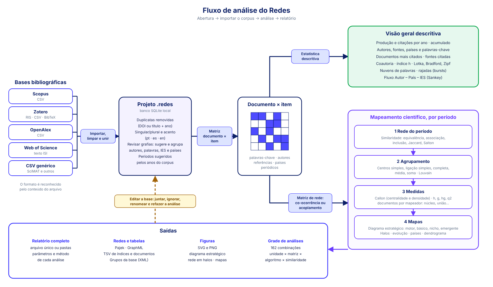

# Fluxo de análise do Redes

O Redes segue a mesma lógica do bibliometrix até a matriz documento × item. Depois dela o caminho se divide em dois: a **estatística descritiva** do corpus e o **mapeamento científico por período**, herdado do SciMAT.

## Etapas

| # | Etapa | O que acontece | Onde fica na ferramenta |
|---|---|---|---|
| 1 | **Importar** | Lê CSV da Scopus, RIS, CSV ou BibTeX do Zotero, OpenAlex, Web of Science (texto ISI) e CSV genérico. O formato é reconhecido pelo conteúdo do arquivo. | Abrir projeto → importar |
| 2 | **Limpar e unir** | Remove duplicatas (mesmo DOI, ou mesmo título e ano), une singular/plural e acento em português, espanhol e inglês, e define os períodos pelos anos do corpus. | Automático na importação |
| 3 | **Projeto `.redes`** | Guarda tudo em um banco SQLite local, com grupos de palavras, autores e países, e a lista de termos ignorados. | Arquivo no seu computador |
| 4 | **Matriz documento × item** | Cada documento recebe 1 ou 0 para cada palavra-chave, autor, referência, país, instituição (IES) ou periódico. | Interna |
| 5a | **Visão geral descritiva** | Produção e citações por ano, rankings de autores, fontes, países e palavras-chave, documentos mais citados, coautoria, leis de Lotka, Bradford e Zipf, nuvens de palavras (palavras-chave dos autores e títulos) e rajadas de palavras-chave e referências, e o fluxo Autor – País – IES (Sankey). | Menu → Visão geral descritiva |
| 5b | **Matriz de rede** | A matriz vira co-ocorrência (itens que aparecem juntos) ou acoplamento (documentos que citam as mesmas referências). | Menu de análises |
| 6 | **Rede do período** | Constrói uma rede por período, com a similaridade escolhida: equivalência, associação, inclusão, Jaccard ou Salton. Na unidade IES, as variantes inequívocas do nome são unidas e componentes com menos de 3 instituições ficam sem agrupamento. | Aba Rede |
| 7 | **Agrupamento** | Forma os temas por centros simples, ligação simples, completa, média, soma ou Louvain. | Modo avançado |
| 8 | **Medidas** | Centralidade e densidade de Callon, índices h, g, hg e q2, e documentos por mapeador (núcleo, união, interseção, k-core e acoplamento). | Abas Índices e Agrupamentos |
| 9 | **Qualidade e rótulos** | Selo de qualidade do mapa (Q, comparação com o Louvain, silhueta) e rótulo por tema (LLR), este só em palavras-chave e referências. | Cartão da análise, tabela de agrupamentos |
| 10 | **Mapas e figuras** | Diagrama estratégico (motor, básico, nicho, emergente), rede em halos, rede de agrupamentos, mapas de evolução e sobreposição entre períodos, rede de países, dendrograma, linha do tempo com rajadas, pontos de virada e mapa de densidade. | Resumo, Diagrama, Comparar períodos, Dendrograma, Linha do tempo, Densidade |
| 11 | **Saídas** | Relatório HTML com as redes, o quadro de métricas e os parâmetros e o método de cada análise, Pajek, GraphML, TSV, XML de grupos, figuras SVG e PNG e a grade de 162 análises. | Exportar e Relatório |
| ↺ | **Editar a base** | Juntar, ignorar ou renomear termos e refazer a análise. É o ciclo que mais se repete no trabalho real. | Base |

## Em relação ao bibliometrix

| | Bibliometrix | Redes |
|---|---|---|
| Bases aceitas | Scopus, Web of Science, Dimensions, Lens, PubMed, Cochrane, OpenAlex | Scopus, Zotero, OpenAlex, Web of Science e CSV genérico |
| Estatística descritiva | Sim | Sim (Visão geral descritiva), incluindo nuvens de palavras e rajadas |
| Mapeamento temático | Um mapa temático para todo o corpus | Um mapa **por período**, com comparação entre períodos |
| Medida de desempenho dos temas | Citações e documentos | Documentos, citações, h, g, hg e q2, por mapeador |
| Edição de grupos e termos | Por código em R | Por tela (Base), com desfazer |
| Uso | Pacote R e aplicativo Shiny | Programa local, em português |

## O que ainda falta neste fluxo

- O selo de qualidade (desde 11/11/2026) depende da fração de itens em agrupamentos de 5 ou mais; a justificativa está em `docs/qualidade.md`. Falta repetir o julgamento visual em outros domínios.
- Rótulos por tema só existem para palavras-chave e referências; autores, países e IES ficam com o nome do líder.
- A linha do tempo e a densidade usam o corpus completo, não o período, e não valem para acoplamento nem cocitação de documentos.
- A visão geral descritiva já entra no relatório HTML, mas as tabelas ainda não têm botão de CSV.
- As rajadas contam documentos do corpus, não citações recebidas como no CiteSpace, e ficam instáveis em corpora com menos de 100 documentos.
- O Zotero não exporta referências, então cocitação e frentes de pesquisa só funcionam com CSV da Scopus.
- Não há instalador para o Mac: o Redes roda pelo Terminal com `python3 -m redes web`.

A figura é gerada por `gera_fluxo.py` (`python3 gera_fluxo.py fluxo-redes.svg`), e o arquivo `.svg` pode ser editado em qualquer programa de desenho.
