# Guia de uso

Passo a passo da interface web. As capturas usam dois corpora públicos de artigos (53 e 147 documentos). Quer testar sem dados próprios? Use [`examples/exemplo_sintetico.csv`](../examples/exemplo_sintetico.csv).

## 1. Abrir

```bash
redes web
```

Abre `http://127.0.0.1:8765` (use `--porta` para mudar e `--nao-abrir` para não abrir o navegador). Também há o app para [macOS e Windows](../README.md#app-para-macos-e-windows).


## 2. Importar o corpus

Clique em *Começar*, arraste ou escolha o arquivo exportado. Em *Opções* (aberto abaixo) ficam o formato (detectado automaticamente), o nome do projeto e os **períodos**: vazio = divisão automática em 1 a 4 períodos; `unico` = um só; ou faixas como `2008-2014, 2015-2020, 2021-2026`. Clique em *Importar e abrir*.

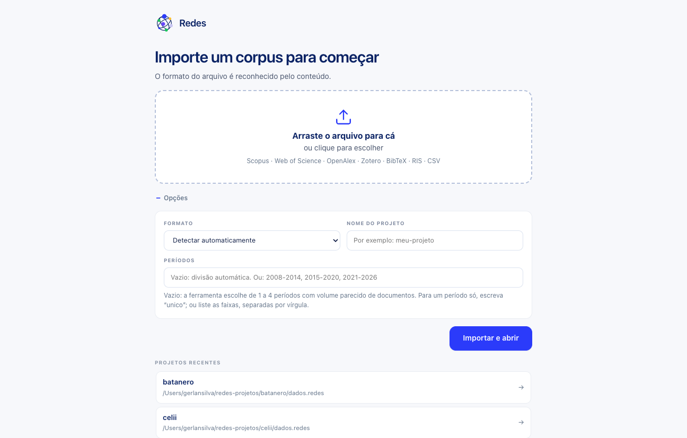

## 3. Visão geral

Perfil do corpus: totais, produção e citações por ano, autores e fontes, nuvem de palavras, rajadas e leis bibliométricas. O que faltar nos dados (por exemplo, citações vazias) é dito na tela.

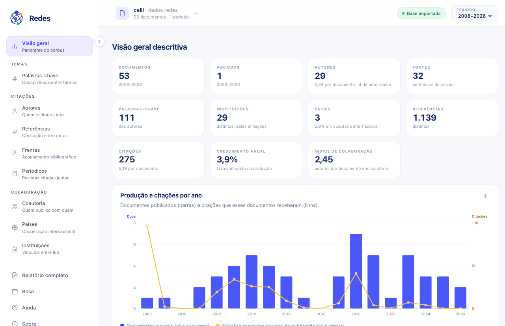

Cada gráfico tem o botão *Salvar gráfico* (SVG, PNG ou dados em CSV):


## 4. Temas

O menu lateral reúne as análises em três grupos: **Temas**, **Citações** e **Colaboração**. Em cada análise, a barra de resultados mostra só as visões que fazem sentido para ela.

### Evolução temática

Em *Palavras-chave*, a primeira visão é a **Evolução temática**: cada coluna é um período e cada círculo, um tema; linhas ligam temas que compartilham itens.

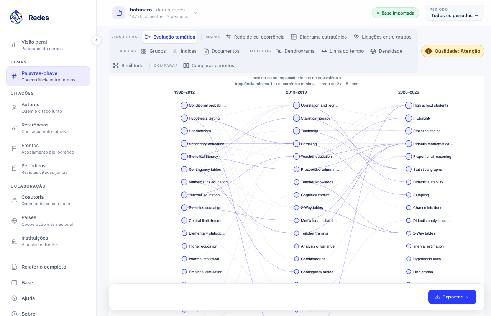

### Diagrama estratégico

Quadrantes Motor, Básico, Nicho e Emergente, por centralidade e densidade (veja [analises.md](analises.md)).

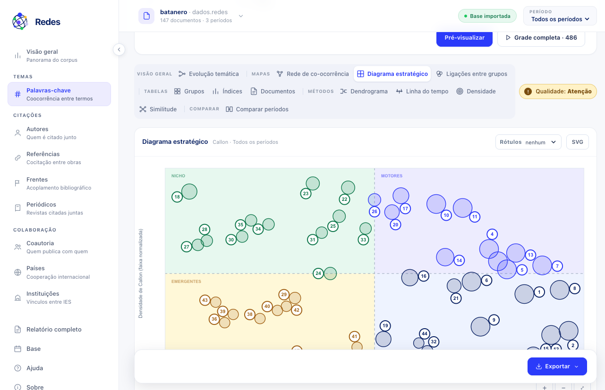

### Rede em halos

A rede usa halos para separar os grupos: cada halo reúne os itens de um tema, e as cores identificam os grupos. Acima da figura ficam os controles de rótulos, nós exibidos, linhas e ajustes.

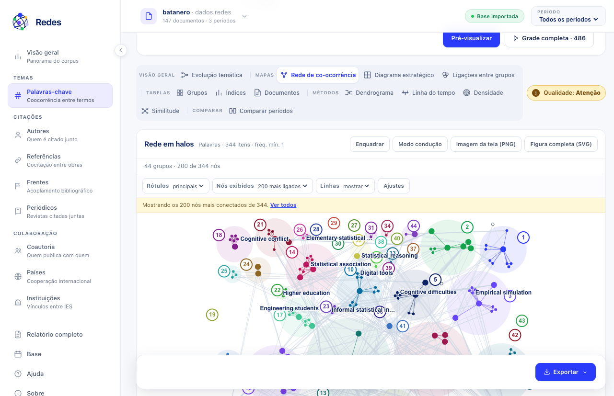

### Períodos

O seletor **Período** (topo da tela) começa em *Todos os períodos* e permite abrir um recorte por vez. A análise não esconde visões: as abas que dependem de mais de um período aparecem quando o projeto tem dois ou mais recortes.

### Frequência mínima

O campo **Frequência mínima** decide quais itens entram na análise, e as predefinições *Padrão*, *Mais estrita* e *Mais ampla* ajustam esse corte de uma vez. Todos os parâmetros ficam à vista — não há modo avançado. O selo **Qualidade** resume a leitura daquele resultado.

## 5. Citações

### Autores

*Autores* mostra quem é citado em conjunto e como esses grupos evoluem. A primeira visão é a *Evolução dos grupos*; *Rede de cocitação*, *Diagrama estratégico*, *Grupos* e *Índices* ficam na mesma barra.

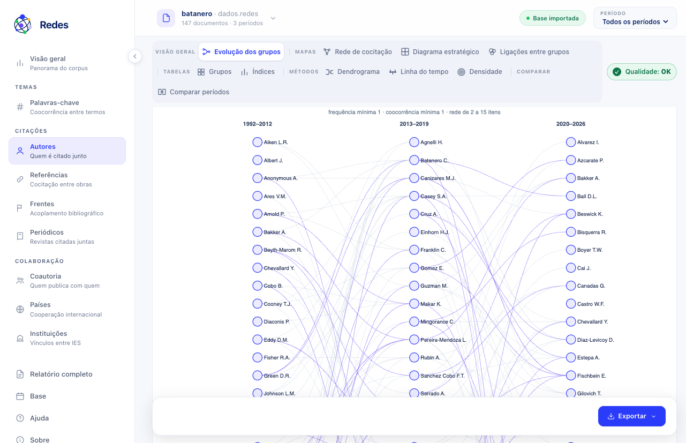

*Referências*, *Frentes* e *Periódicos* seguem a mesma lógica, com a unidade e a matriz indicadas no topo da análise.

## 6. Colaboração

### Coautoria

Quem publica com quem. A barra traz *Rede de coautoria*, *Dendrograma*, *Linha do tempo* e *Densidade*. A espessura da linha é o número de documentos em que o par aparece.

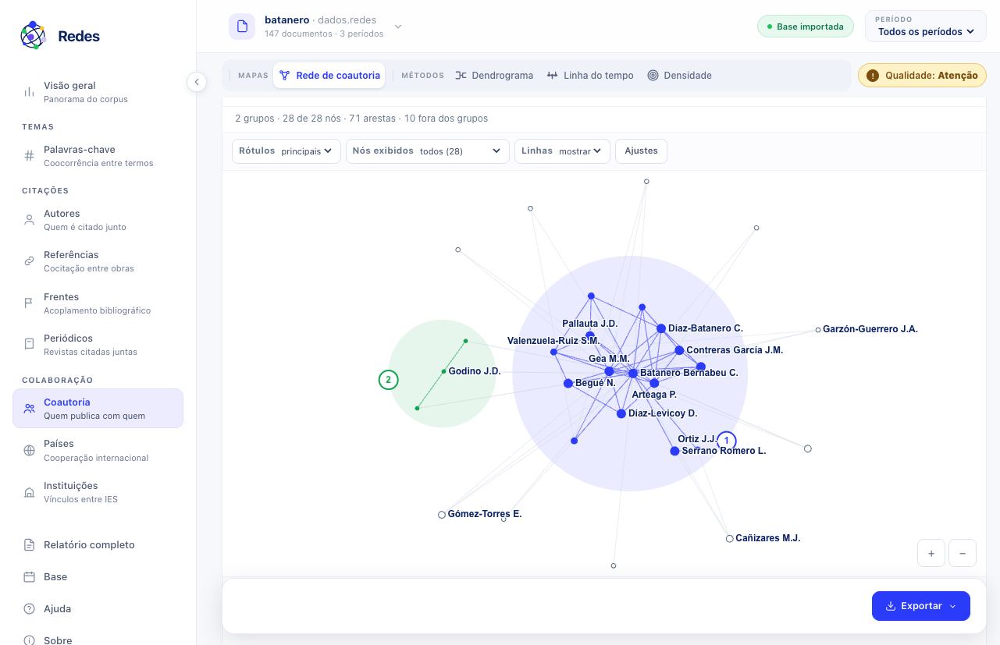

### Países

O mapa de colaboração mostra os países e as cooperações; *Densidade* fica na aba ao lado.

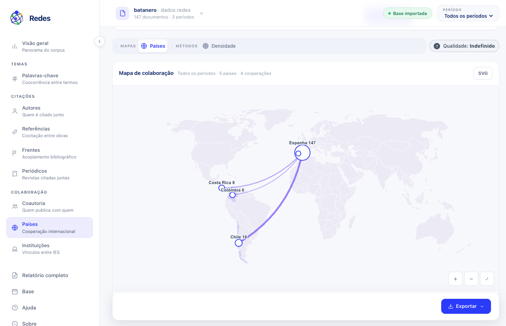

### Instituições

A rede de vínculos entre IES e a densidade dessa rede.

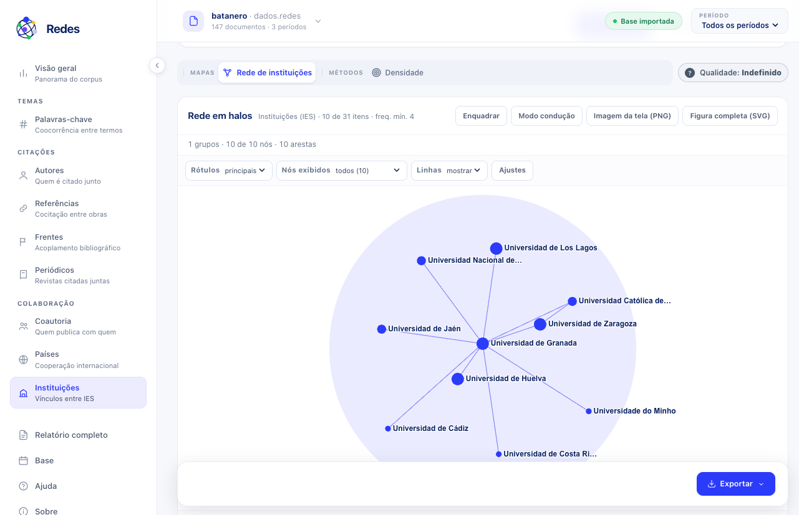

## 7. Exportar

O menu *Exportar* gera relatórios HTML e dados (TSV, Pajek, GraphML, XML de grupos, SVG).

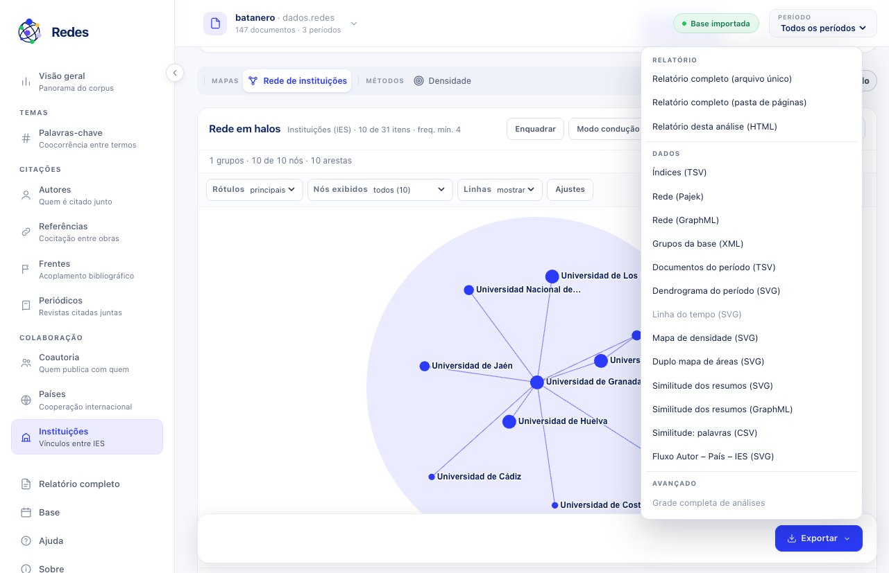

## 8. Relatório completo

*Relatório completo* (menu lateral) abre em nova aba um HTML com todas as análises que a base permite, período a período, com as ressalvas de leitura de cada corpus.

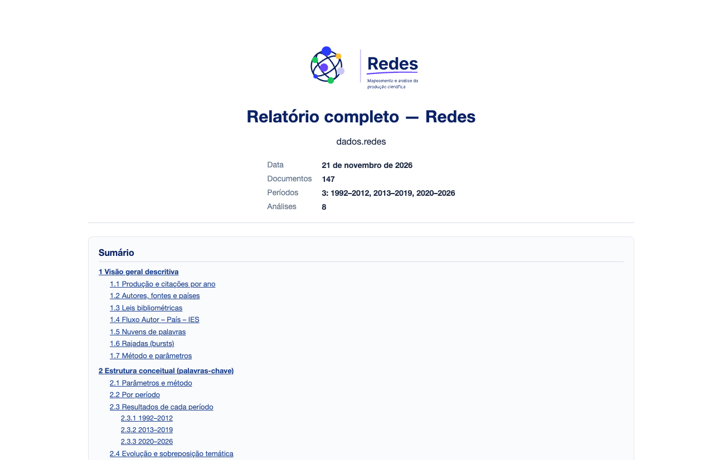

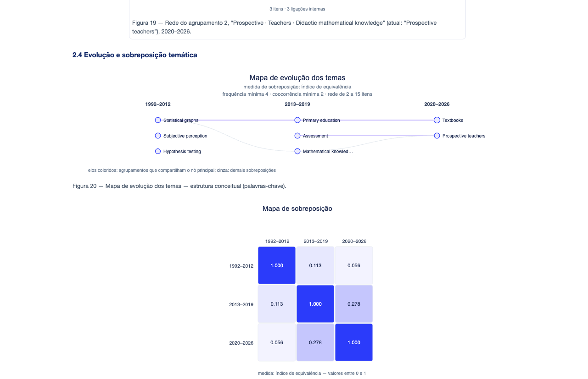

## Base e grafias

A tela *Base* edita períodos e junta grafias de autores, palavras-chave, instituições e países, com sugestões e desfazer.
